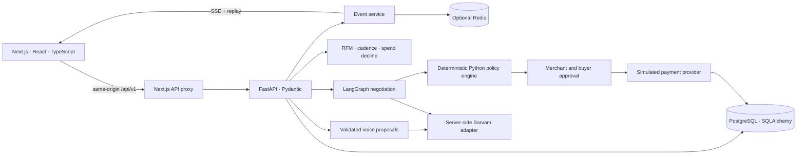

# Pehchaan architecture

Pehchaan is a local-first hackathon proof of concept. All merchant and customer records are synthetic. No route moves real money or sends customer messages.

## Process boundaries

The API owns database access, financial calculations, signing, upload validation, provider keys, and mutation approval. The browser displays public quotes and merchant-owned catalogue data, never seller confidential floors. Next.js proxies requests; it does not contain a Sarvam key.

## Storage and deterministic seed

`apps/api/app/models` defines SQLAlchemy records; Alembic manages schema migrations. PostgreSQL is the primary deployment database. An explicitly configured SQLite fallback keeps a credential-free demo runnable on a laptop. The local development configuration in this workspace uses a separate `pehchaan` PostgreSQL database.

The seed uses a fixed random seed, 100 pseudonymous customer tokens, 90 days of purchases, stock and product records, historical campaign records, three seller catalogues, and audit activity. Dashboard aggregates are computed from these stored records. Reset rebuilds only the application's demo database; do not point a demo deployment at a production database.

RFM combines recency, frequency, and monetary value. Inactivity uses the customer's observed intervisit cadence and variance with minimum-history safeguards. Spend decline compares current and preceding comparable periods. A new customer cannot be classified as a lost regular merely from a short observation window. None of these signals imply purchases at competitors.

## Campaign experiments

Campaigns validate offer amount, minimum bill, merchant margin, customer allocation, and total discount exposure. Reproducible assignments include treatment variants and a control. The simulator writes actual synthetic redemption and purchase records; a repeat simulation uses the stored assignments rather than multiplying outcomes. Incremental gross profit is an estimate relative to control. Attribution remains preliminary unless there are at least 30 treatment assignments, 20 controls, 20 observed returns, and a two-sided Fisher exact test reaches p < 0.05. Predictions and simulated observations are separate concepts in the interface.

## Negotiation and mandates

The negotiation is a LangGraph `StateGraph`, with buyer parsing, catalogue normalization, seller quote collection, buyer evaluation, counteroffers, policy validation, bundle optimization, and approval stages. Four is the maximum round count. Deterministic arithmetic controls prices; an optional Sarvam call supplies a concise negotiation rationale. Public events contain structured actions and summaries, never hidden model reasoning.

The mandate firewall is a separate Python service. It checks operation permission, buyer budget, private seller floor, discount, stock, delivery, expiry, round count, required confirmations, signature, replay and idempotency rules. HMAC-SHA256 protects signed policy envelopes; constant-time comparison verifies signatures. HMAC integrity does not replace the amount and permission checks. Decisions are persisted and public rejection reasons do not reveal seller floor values.

A selected deal is a proposal. Order confirmation and payment simulation require the explicit approvals exposed in the UI. Cancellation and pause controls apply to the workflow state, not cosmetic graph animation.

## Provider boundaries

Sarvam requests execute on the API server. Missing credentials, denied model access, timeouts, and rate limits return visibly labelled demo/provider-unavailable results. They are never described as successful real model calls. STT accepts short validated recordings with a 30-second synchronous limit. TTS base64 output becomes playable audio. Hindi and Marathi use `hi-IN` and `mr-IN`.

Document extraction is advisory and requires review before catalogue saving or negotiation. The document adapter exposes a labelled demo fallback when the provider contract/access is unavailable. The payment provider is always simulated in this proof of concept. A future Paytm adapter needs an authorized commercial integration, credentials, webhook verification, and deployment authentication; no current Paytm capability is implied.

## Events and reconnects

Persistent audit events are the source of truth. SSE transports status, campaign, quote, policy, voice, and payment events. Event IDs support reconnect replay. Redis can distribute ephemeral notifications when configured; unavailability is reported in health and does not erase persistent events. Agent Command Center status derives from application events and run state.

## Security and deployment scope

This is a single-merchant local demo. It is not a production multi-tenant authentication system. Keep both servers bound to localhost for native development; Compose publishes only loopback ports. Before external deployment, add authenticated identities, tenant/role enforcement at the API boundary, TLS, persistent signing-secret management, production rate limiting, access-controlled uploads, and database backup/retention controls. Merchant-owned cost and floor fields belong behind authenticated merchant authorization in production.

`.env` is ignored; `.env.example` contains placeholders. Uploads have type/size checks and safe handling. Expensive provider operations use bounded timeouts. Financial mutation paths use deterministic validation, approvals and persistent records. Logs must not contain subscription keys or customer identifiers beyond synthetic tokens.

## Verification

`make test`, `make check`, `make build`, and `make e2e` cover unit behavior, type safety, lint, production compilation, and browser workflows. Backend tests use isolated fixtures, not the interactive PostgreSQL demo database. See the final README verification notes for checks actually executed in this environment.
